# Results: a freshness-aware load balancer (FALB) under stale load information

Testbed data: `results\testbed\runs.csv` (315 runs). All figures are in this folder.

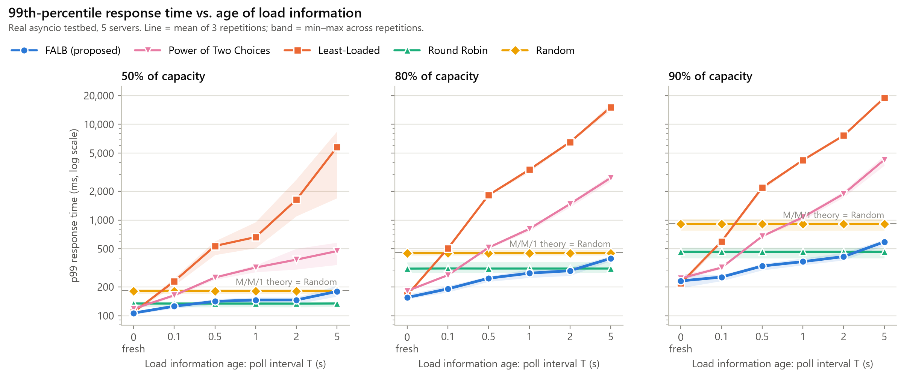

## Hypotheses

Verdicts compare the mean p99 over repetitions. A comparison is *clear* when every repetition of one strategy beat every repetition of the other, and *within noise* otherwise.

### H1: FALB has a lower p99 than Least-Loaded once information is moderately or very stale (T ≥ 0.5 s)

- 50% load: **supported**. T=0.5: 141 vs 536 ms (×3.8, clear); T=1: 146 vs 663 ms (×4.5, clear); T=2: 146 vs 1,631 ms (×11.2, clear); T=5: 179 vs 5,808 ms (×32.4, clear).
- 80% load: **supported**. T=0.5: 246 vs 1,821 ms (×7.4, clear); T=1: 278 vs 3,361 ms (×12.1, clear); T=2: 295 vs 6,524 ms (×22.1, clear); T=5: 397 vs 15,118 ms (×38.1, clear).
- 90% load: **supported**. T=0.5: 331 vs 2,183 ms (×6.6, clear); T=1: 367 vs 4,226 ms (×11.5, clear); T=2: 414 vs 7,640 ms (×18.4, clear); T=5: 591 vs 18,950 ms (×32.0, clear).

### H2: FALB matches or beats the Power of Two Choices when information is fresh (T ≤ 0.1 s)

*Matches* means the two are within noise; *beats* means a lower mean p99.

- 50% load: **supported**. T=0: FALB 107 ± 4 vs P2C 118 ± 5 ms (beats, clear); T=0.1: FALB 126 ± 5 vs P2C 163 ± 6 ms (beats, clear).
- 80% load: **supported**. T=0: FALB 155 ± 10 vs P2C 182 ± 4 ms (beats, clear); T=0.1: FALB 191 ± 15 vs P2C 265 ± 5 ms (beats, clear).
- 90% load: **supported**. T=0: FALB 231 ± 41 vs P2C 246 ± 17 ms (beats, within noise); T=0.1: FALB 253 ± 20 vs P2C 318 ± 11 ms (beats, clear).

### H3: FALB keeps response times stable when a server stops reporting or slows down, while Round Robin and Random build long queues on the slow server

- **Missing report: one server silent for 10 s** (load 80%, T = 0.5 s). p99 during the event: FALB (proposed) 283 ms, Power of Two Choices 750 ms, Least-Loaded 5,035 ms, Round Robin 245 ms, Random 392 ms. FALB's event p99 is ×1.15 its p99 with no event (246 ms). Longest queue on the affected server: FALB (proposed) 17, Power of Two Choices 42, Least-Loaded 276, Round Robin 14, Random 18. Best during the event: **Round Robin**.
- **Slow server: one server 2x slower for 20 s** (load 80%, T = 0.5 s). p99 during the event: FALB (proposed) 401 ms, Power of Two Choices 996 ms, Least-Loaded 3,131 ms, Round Robin 7,206 ms, Random 7,360 ms. FALB's event p99 is ×1.63 its p99 with no event (246 ms). Longest queue on the affected server: FALB (proposed) 15, Power of Two Choices 33, Least-Loaded 98, Round Robin 296, Random 296. Best during the event: **FALB (proposed)**.

## FALB against the best baseline in every cell

FALB has the lowest p99 in **11 of 18** staleness × load cells. Negative = FALB is faster.

| Load | T (s) | FALB p99 (ms) | best baseline | its p99 (ms) | FALB vs. best baseline |
|---:|---:|---:|---|---:|---:|
| 50% | 0 | 107 | Least-Loaded | 109 | **-2%** |
| 50% | 0.1 | 126 | Round Robin | 134 | **-6%** |
| 50% | 0.5 | 141 | Round Robin | 134 | +5% |
| 50% | 1 | 146 | Round Robin | 134 | +9% |
| 50% | 2 | 146 | Round Robin | 134 | +9% |
| 50% | 5 | 179 | Round Robin | 134 | +34% |
| 80% | 0 | 155 | Least-Loaded | 165 | **-6%** |
| 80% | 0.1 | 191 | Power of Two Choices | 265 | **-28%** |
| 80% | 0.5 | 246 | Round Robin | 311 | **-21%** |
| 80% | 1 | 278 | Round Robin | 311 | **-11%** |
| 80% | 2 | 295 | Round Robin | 311 | **-5%** |
| 80% | 5 | 397 | Round Robin | 311 | +28% |
| 90% | 0 | 231 | Least-Loaded | 219 | +6% |
| 90% | 0.1 | 253 | Power of Two Choices | 318 | **-20%** |
| 90% | 0.5 | 331 | Round Robin | 465 | **-29%** |
| 90% | 1 | 367 | Round Robin | 466 | **-21%** |
| 90% | 2 | 414 | Round Robin | 465 | **-11%** |
| 90% | 5 | 591 | Round Robin | 466 | +27% |

## p99 response time (staleness scenario)

**50% of capacity** (p99, ms, mean ± sd)

| T (s) | FALB (proposed) | Power of Two Choices | Least-Loaded | Round Robin | Random |
|---:|---:|---:|---:|---:|---:|
| 0 | 107 ± 4 | 118 ± 5 | 109 ± 1 | 134 ± 9 | 180 ± 11 |
| 0.1 | 126 ± 5 | 163 ± 6 | 229 ± 20 | 134 ± 10 | 181 ± 11 |
| 0.5 | 141 ± 10 | 251 ± 11 | 536 ± 91 | 134 ± 10 | 181 ± 11 |
| 1 | 146 ± 14 | 319 ± 29 | 663 ± 250 | 134 ± 9 | 181 ± 11 |
| 2 | 146 ± 12 | 385 ± 104 | 1,631 ± 894 | 134 ± 10 | 181 ± 11 |
| 5 | 179 ± 24 | 474 ± 123 | 5,808 ± 3,615 | 134 ± 9 | 181 ± 11 |

**80% of capacity** (p99, ms, mean ± sd)

| T (s) | FALB (proposed) | Power of Two Choices | Least-Loaded | Round Robin | Random |
|---:|---:|---:|---:|---:|---:|
| 0 | 155 ± 10 | 182 ± 4 | 165 ± 4 | 311 ± 45 | 450 ± 33 |
| 0.1 | 191 ± 15 | 265 ± 5 | 505 ± 20 | 312 ± 46 | 450 ± 34 |
| 0.5 | 246 ± 17 | 515 ± 15 | 1,821 ± 38 | 311 ± 46 | 450 ± 33 |
| 1 | 278 ± 28 | 808 ± 39 | 3,361 ± 178 | 311 ± 46 | 450 ± 33 |
| 2 | 295 ± 31 | 1,473 ± 96 | 6,524 ± 114 | 311 ± 46 | 450 ± 32 |
| 5 | 397 ± 24 | 2,760 ± 210 | 15,118 ± 1,278 | 311 ± 46 | 450 ± 33 |

**90% of capacity** (p99, ms, mean ± sd)

| T (s) | FALB (proposed) | Power of Two Choices | Least-Loaded | Round Robin | Random |
|---:|---:|---:|---:|---:|---:|
| 0 | 231 ± 41 | 246 ± 17 | 219 ± 15 | 466 ± 60 | 911 ± 125 |
| 0.1 | 253 ± 20 | 318 ± 11 | 596 ± 21 | 465 ± 59 | 911 ± 125 |
| 0.5 | 331 ± 28 | 676 ± 18 | 2,183 ± 109 | 465 ± 60 | 911 ± 125 |
| 1 | 367 ± 30 | 1,069 ± 63 | 4,226 ± 63 | 466 ± 60 | 910 ± 125 |
| 2 | 414 ± 38 | 1,875 ± 140 | 7,640 ± 221 | 465 ± 60 | 911 ± 125 |
| 5 | 591 ± 46 | 4,266 ± 515 | 18,950 ± 284 | 466 ± 60 | 911 ± 125 |

## Scenarios

**Missing report: one server silent for 10 s** (load 80%, T = 0.5 s, 3 repetitions)

| Strategy | mean (ms) | p99 (ms) | p99 during event (ms) | max queue | CoV |
|---|---:|---:|---:|---:|---:|
| FALB (proposed) | 64 ± 1 | 247 ± 19 | 283 ± 109 | 19 ± 6 | 0.016 ± 0.005 |
| Power of Two Choices | 151 ± 15 | 715 ± 326 | 750 ± 377 | 48 ± 20 | 0.028 ± 0.011 |
| Least-Loaded | 652 ± 140 | 4,716 ± 2,679 | 5,035 ± 3,008 | 276 ± 148 | 0.046 ± 0.012 |
| Round Robin | 66 ± 2 | 312 ± 46 | 245 ± 45 | 20 ± 5 | 0.000 ± 0.000 |
| Random | 101 ± 2 | 450 ± 33 | 392 ± 45 | 30 ± 2 | 0.017 ± 0.002 |

**Slow server: one server 2x slower for 20 s** (load 80%, T = 0.5 s, 3 repetitions)

| Strategy | mean (ms) | p99 (ms) | p99 during event (ms) | max queue | CoV |
|---|---:|---:|---:|---:|---:|
| FALB (proposed) | 78 ± 5 | 339 ± 55 | 401 ± 91 | 19 ± 4 | 0.075 ± 0.009 |
| Power of Two Choices | 168 ± 6 | 760 ± 60 | 996 ± 224 | 39 ± 1 | 0.061 ± 0.006 |
| Least-Loaded | 564 ± 22 | 2,328 ± 318 | 3,131 ± 260 | 109 ± 6 | 0.068 ± 0.009 |
| Round Robin | 648 ± 92 | 6,748 ± 902 | 7,206 ± 757 | 296 ± 35 | 0.000 ± 0.000 |
| Random | 675 ± 18 | 6,927 ± 336 | 7,360 ± 283 | 296 ± 12 | 0.017 ± 0.002 |

**4 balancers sharing one snapshot** (load 90%, T = 1 s, 3 repetitions)

| Strategy | mean (ms) | p99 (ms) | max queue | CoV |
|---|---:|---:|---:|---:|
| FALB (proposed) | 155 ± 14 | 599 ± 61 | 40 ± 5 | 0.017 ± 0.010 |
| Power of Two Choices | 320 ± 2 | 1,100 ± 46 | 73 ± 5 | 0.018 ± 0.009 |
| Least-Loaded | 1,466 ± 60 | 3,935 ± 99 | 224 ± 18 | 0.043 ± 0.018 |
| Round Robin | 123 ± 14 | 467 ± 61 | 31 ± 5 | 0.000 ± 0.000 |
| Random | 199 ± 16 | 887 ± 110 | 57 ± 7 | 0.011 ± 0.002 |

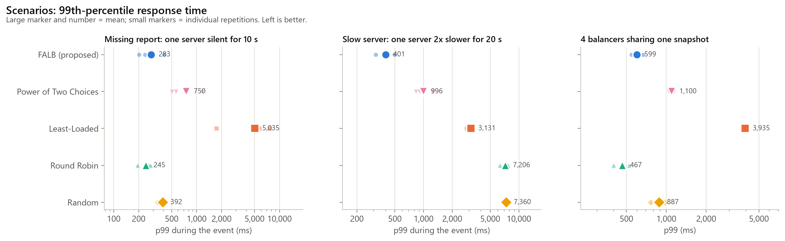

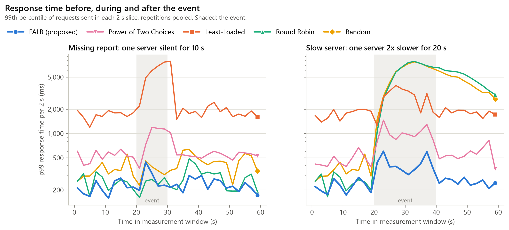

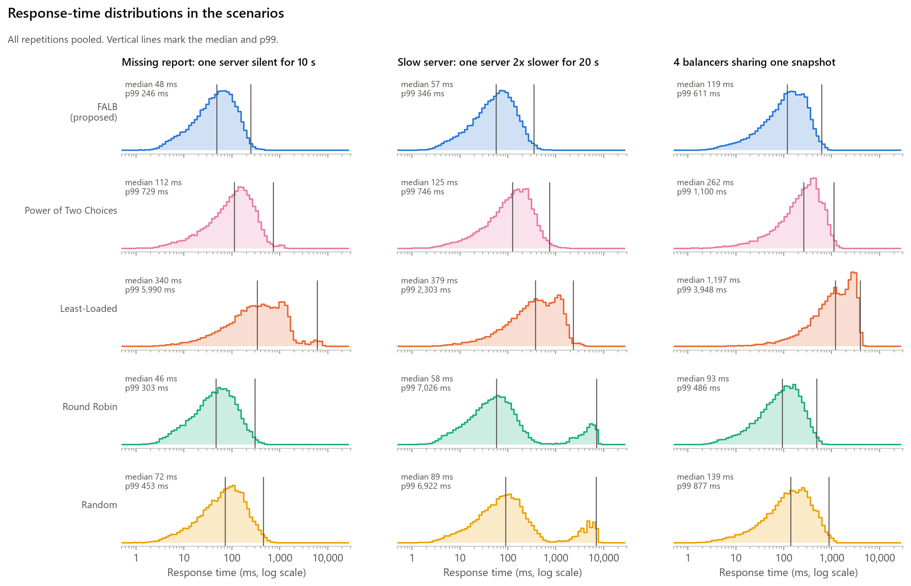

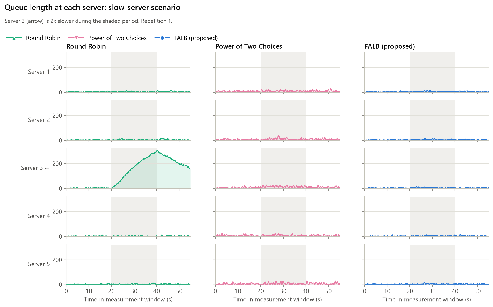

## Other metrics

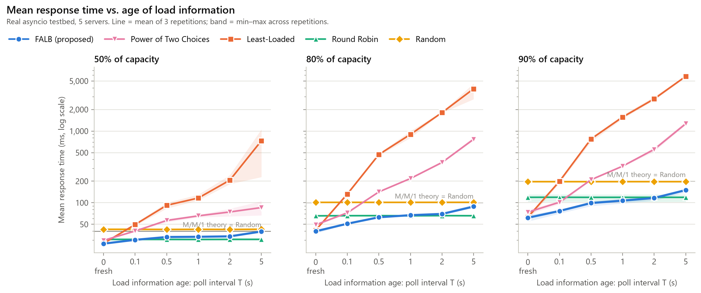

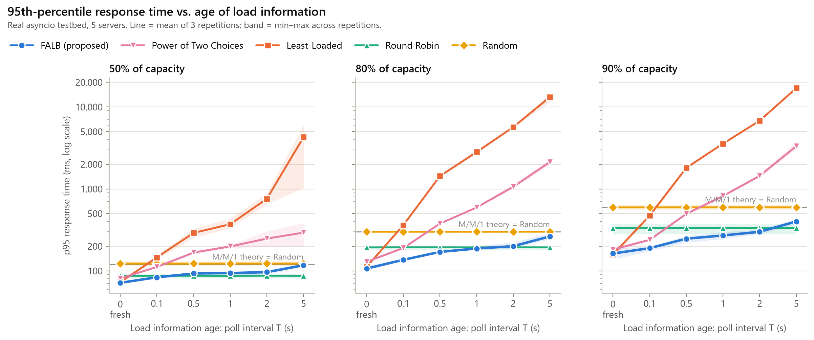

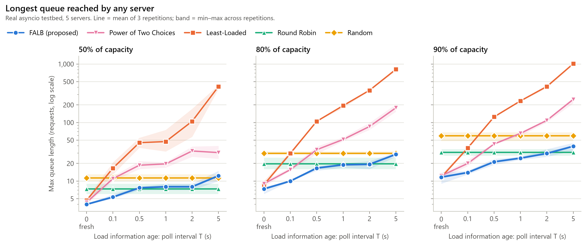

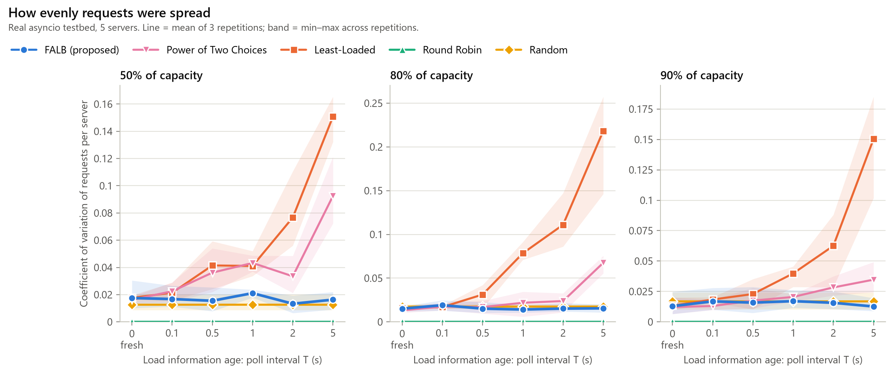

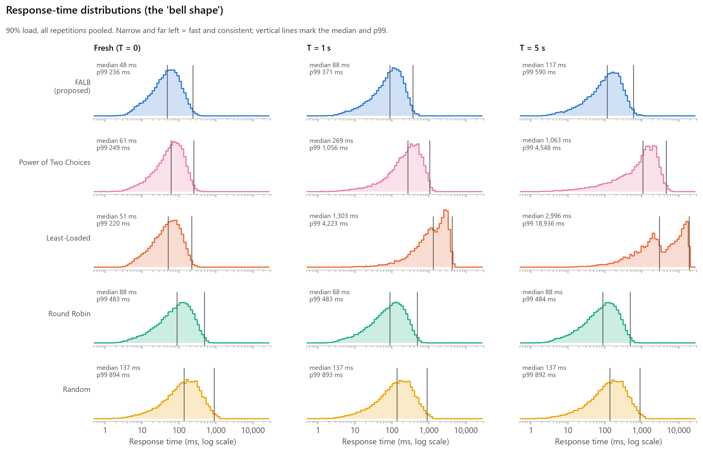

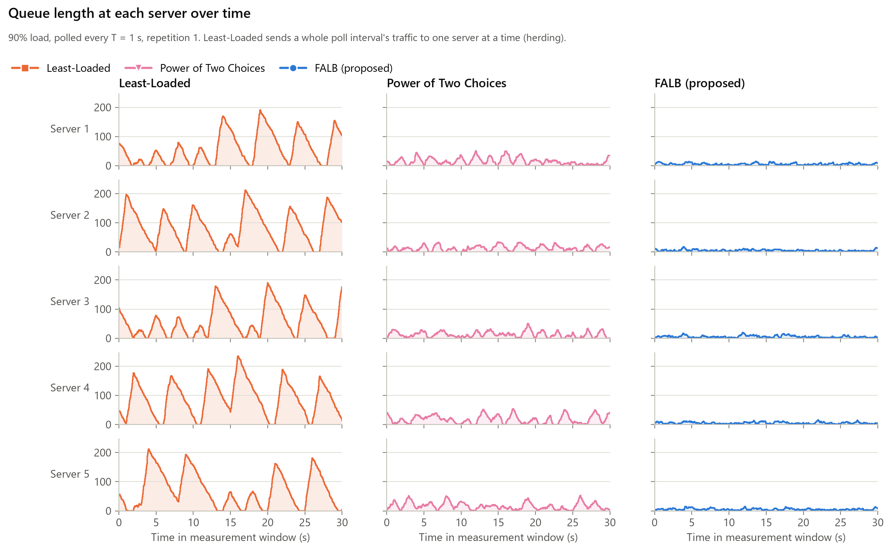

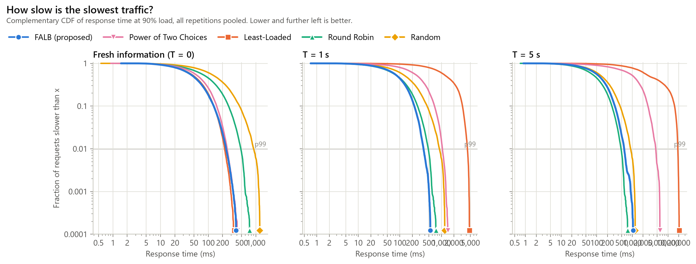

## Decision time

Time the balancer spends choosing a server, measured around the strategy code only (with T = 0 the status probes themselves take a further 0.66 ms round trip).

| Strategy | mean, T > 0 (µs) | mean, T = 0 (µs) | median of per-run max (µs) |
|---|---:|---:|---:|
| FALB (proposed) | 26.6 | 21.0 | 856 |
| Power of Two Choices | 21.9 | 10.1 | 834 |
| Least-Loaded | 17.2 | 13.4 | 812 |
| Round Robin | 4.2 | 4.0 | 744 |
| Random | 8.5 | 8.4 | 781 |

## Testbed sanity checks

Random assignment turns each server into an M/M/1 queue, so its measurements can be checked against theory. Theory uses the load actually offered in the window (Poisson arrivals vary from window to window). Runs of the same repetition share their random seeds, so only distinct repetitions are independent samples.

| Target load | offered load | measured mean (ms) | M/M/1 mean | measured p99 (ms) | M/M/1 p99 | independent samples |
|---:|---:|---:|---:|---:|---:|---:|
| 50% | 49.7% | 42.5 | 39.8 | 181 | 183 | 3 |
| 80% | 79.8% | 101.3 | 98.8 | 450 | 455 | 3 |
| 90% | 90.3% | 196.9 | 206.5 | 911 | 951 | 3 |

A short window also under-reads the p99 on its own: a queue's worst excursions are rare, and a single minute often misses them. The simulator shows the size of this effect (see *Testbed vs. simulation*, which compares like with like: the same window length, repeated 20 times).

- Runs: 315; requests measured: 3,529,170; timed out: 0.
- Achieved vs. target arrival rate: 99.8% on average.
- Load generator send lag (actual minus scheduled send time): mean 0.79 ms, worst run p99 2.18 ms.

## Testbed vs. simulation

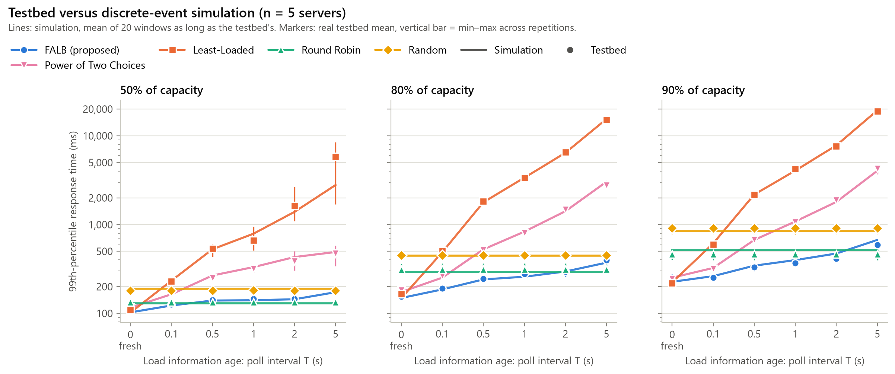

## Scenarios in simulation (20 repetitions each)

The testbed runs each scenario 3 times; the simulator repeats them 20 times to show the noise-free picture.

**Missing report: one server silent for 10 s** (load 80%, T = 0.5 s, 20 repetitions)

| Strategy | mean (ms) | p99 (ms) | p99 during event (ms) | max queue | CoV |
|---|---:|---:|---:|---:|---:|
| FALB (proposed) | 60 ± 2 | 250 ± 18 | 278 ± 58 | 17 ± 3 | 0.016 ± 0.006 |
| Power of Two Choices | 153 ± 20 | 769 ± 631 | 863 ± 780 | 51 ± 41 | 0.033 ± 0.023 |
| Least-Loaded | 597 ± 139 | 3,290 ± 2,686 | 3,717 ± 3,154 | 192 ± 155 | 0.064 ± 0.019 |
| Round Robin | 62 ± 4 | 292 ± 52 | 291 ± 97 | 20 ± 4 | 0.000 ± 0.000 |
| Random | 99 ± 7 | 447 ± 77 | 449 ± 181 | 31 ± 6 | 0.018 ± 0.005 |

**Slow server: one server 2x slower for 20 s** (load 80%, T = 0.5 s, 20 repetitions)

| Strategy | mean (ms) | p99 (ms) | p99 during event (ms) | max queue | CoV |
|---|---:|---:|---:|---:|---:|
| FALB (proposed) | 74 ± 4 | 344 ± 38 | 446 ± 61 | 18 ± 3 | 0.082 ± 0.011 |
| Power of Two Choices | 166 ± 7 | 791 ± 106 | 1,036 ± 136 | 37 ± 3 | 0.068 ± 0.011 |
| Least-Loaded | 556 ± 29 | 2,267 ± 245 | 3,082 ± 439 | 109 ± 8 | 0.078 ± 0.017 |
| Round Robin | 663 ± 82 | 7,225 ± 753 | 7,557 ± 715 | 309 ± 30 | 0.000 ± 0.000 |
| Random | 722 ± 123 | 7,431 ± 1,038 | 7,728 ± 1,014 | 316 ± 38 | 0.018 ± 0.005 |

**4 balancers sharing one snapshot** (load 90%, T = 1 s, 20 repetitions)

| Strategy | mean (ms) | p99 (ms) | max queue | CoV |
|---|---:|---:|---:|---:|
| FALB (proposed) | 145 ± 16 | 562 ± 64 | 37 ± 6 | 0.016 ± 0.006 |
| Power of Two Choices | 322 ± 16 | 1,058 ± 69 | 66 ± 7 | 0.019 ± 0.008 |
| Least-Loaded | 1,478 ± 104 | 4,008 ± 176 | 227 ± 12 | 0.035 ± 0.012 |
| Round Robin | 124 ± 14 | 523 ± 100 | 33 ± 6 | 0.000 ± 0.000 |
| Random | 193 ± 26 | 780 ± 116 | 48 ± 7 | 0.014 ± 0.006 |

## Ablation (simulation)

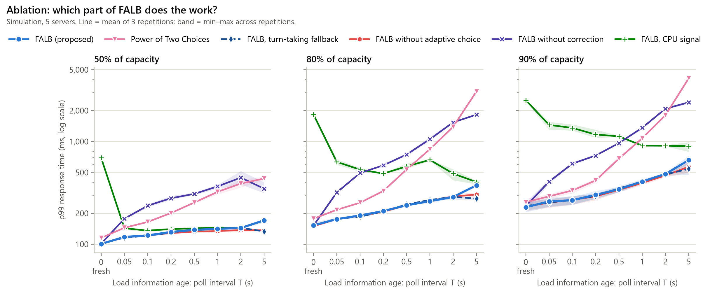

Each variant switches one FALB component off: *without correction* uses the raw reports; *without adaptive choice* always compares all servers and never times out; *CPU signal* replaces queue length with CPU utilization. *Turn-taking fallback* is a design alternative: servers whose reports timed out take turns instead of being picked at random.

**90% of capacity** (p99, ms, mean ± sd)

| T (s) | FALB (proposed) | Power of Two Choices | FALB, turn-taking fallback | FALB without adaptive choice | FALB without correction | FALB, CPU signal |
|---:|---:|---:|---:|---:|---:|---:|
| 0 | 229 ± 22 | 256 ± 19 | 235 ± 24 | 232 ± 26 | 236 ± 24 | 2,527 ± 46 |
| 0.05 | 261 ± 28 | 293 ± 15 | 255 ± 22 | 254 ± 25 | 406 ± 18 | 1,450 ± 129 |
| 0.1 | 268 ± 25 | 334 ± 20 | 269 ± 26 | 270 ± 25 | 609 ± 17 | 1,357 ± 99 |
| 0.2 | 302 ± 26 | 417 ± 18 | 295 ± 17 | 293 ± 22 | 730 ± 18 | 1,169 ± 117 |
| 0.5 | 343 ± 19 | 682 ± 24 | 350 ± 26 | 338 ± 18 | 965 ± 12 | 1,124 ± 16 |
| 1 | 408 ± 7 | 1,075 ± 19 | 408 ± 21 | 395 ± 16 | 1,361 ± 38 | 912 ± 31 |
| 2 | 483 ± 16 | 1,804 ± 43 | 479 ± 17 | 467 ± 18 | 2,088 ± 38 | 910 ± 13 |
| 5 | 659 ± 61 | 4,132 ± 220 | 541 ± 74 | 569 ± 78 | 2,405 ± 84 | 903 ± 98 |

## Larger pools (simulation)

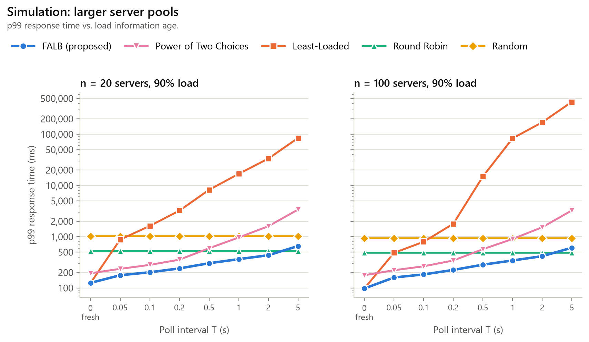

## Several balancers (simulation)

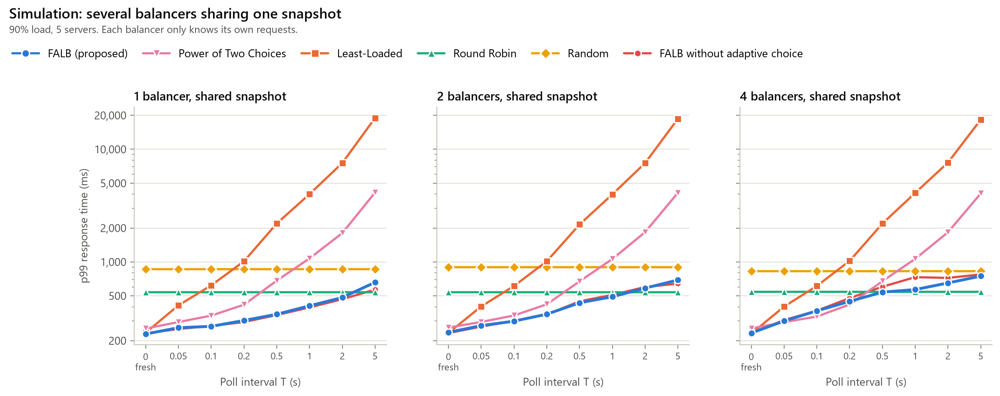

With one balancer FALB's correction sees every request, and comparing all servers is safe. With several balancers each correction sees only part of the traffic; here the random two-choice step of FALB's adaptive choice limits the herding that returns (compare FALB with *FALB without adaptive choice*).

| balancers | T (s) | FALB | FALB without adaptive choice | P2C |
|---:|---:|---:|---:|---:|
| 1 | 0 | 229 | 232 | 256 |
| 1 | 0.05 | 261 | 254 | 293 |
| 1 | 0.1 | 268 | 270 | 334 |
| 1 | 0.2 | 302 | 293 | 417 |
| 1 | 0.5 | 343 | 338 | 682 |
| 1 | 1 | 408 | 395 | 1,075 |
| 1 | 2 | 483 | 467 | 1,804 |
| 1 | 5 | 659 | 569 | 4,132 |
| 2 | 0 | 237 | 234 | 261 |
| 2 | 0.05 | 272 | 267 | 293 |
| 2 | 0.1 | 298 | 299 | 335 |
| 2 | 0.2 | 344 | 341 | 421 |
| 2 | 0.5 | 434 | 447 | 673 |
| 2 | 1 | 491 | 510 | 1,062 |
| 2 | 2 | 585 | 599 | 1,840 |
| 2 | 5 | 692 | 642 | 4,108 |
| 4 | 0 | 234 | 235 | 257 |
| 4 | 0.05 | 299 | 305 | 292 |
| 4 | 0.1 | 368 | 369 | 327 |
| 4 | 0.2 | 447 | 478 | 419 |
| 4 | 0.5 | 539 | 603 | 675 |
| 4 | 1 | 569 | 732 | 1,065 |
| 4 | 2 | 651 | 722 | 1,833 |
| 4 | 5 | 749 | 775 | 4,056 |
