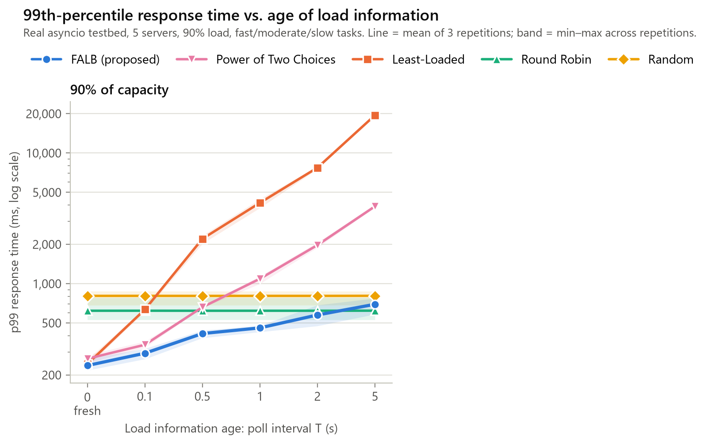
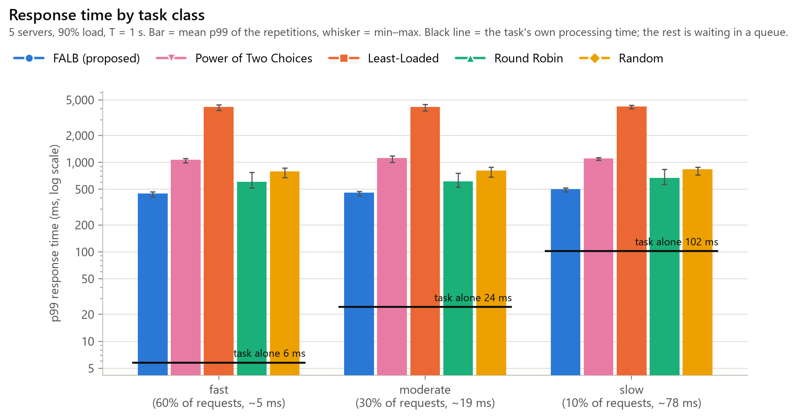
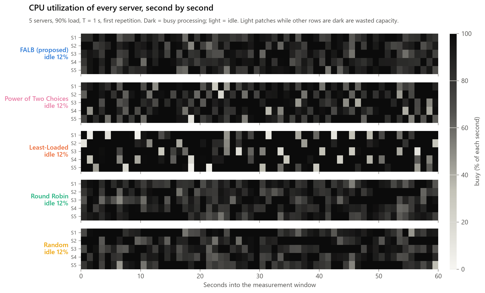
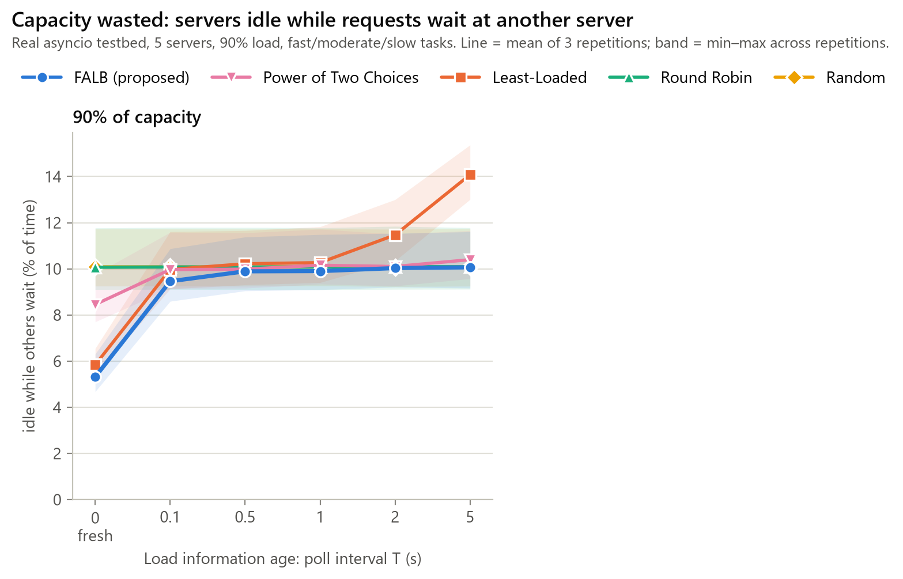
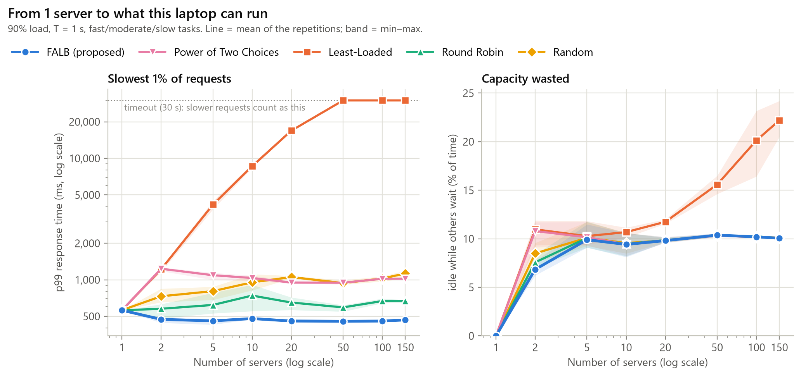

# Follow-up: task classes, per-server utilization and more servers

Testbed data: `results\testbed_nodes\runs.csv` (185 runs). All figures are in this folder.

## Workload: fast, moderate and slow tasks

| Class | share of requests | payload | measured mean | median | p95 |
|---|---:|---:|---:|---:|---:|
| fast | 60% | 128 KB | 4.6 ms | 4.5 ms | 5.3 ms |
| moderate | 30% | 512 KB | 19.1 ms | 18.7 ms | 21.4 ms |
| slow | 10% | 2,048 KB | 77.5 ms | 75.7 ms | 90.4 ms |

Average request: 16.2 ms, so one server handles about 62 requests/s. Each task compresses a block of text with zlib; timed 200 times per class on 2026-10-26 23:23:16.

## Response time vs. age of load information (5 servers)

p99 response time, ms, mean ± sd (90% load):

| T (s) | FALB (proposed) | Power of Two Choices | Least-Loaded | Round Robin | Random |
|---:|---:|---:|---:|---:|---:|
| 0 | 236 ± 27 | 267 ± 19 | 243 ± 17 | 620 ± 140 | 807 ± 107 |
| 0.1 | 293 ± 27 | 341 ± 19 | 635 ± 19 | 621 ± 140 | 807 ± 107 |
| 0.5 | 415 ± 28 | 661 ± 12 | 2,205 ± 161 | 620 ± 140 | 806 ± 107 |
| 1 | 459 ± 28 | 1,091 ± 80 | 4,158 ± 327 | 621 ± 140 | 807 ± 107 |
| 2 | 576 ± 106 | 1,975 ± 91 | 7,726 ± 186 | 621 ± 140 | 806 ± 106 |
| 5 | 696 ± 99 | 3,908 ± 103 | 19,476 ± 236 | 621 ± 140 | 807 ± 105 |

## Response time by task class

Lowest p99: **FALB (proposed)** (459 ms). FALB 459 ms, Round Robin 621 ms.

| Strategy | fast p99 (ms) | moderate p99 (ms) | slow p99 (ms) |
|---|---:|---:|---:|
| *task alone* | *6* | *24* | *102* |
| FALB (proposed) | 449 ± 32 | 459 ± 28 | 502 ± 29 |
| Power of Two Choices | 1,067 ± 68 | 1,116 ± 97 | 1,106 ± 41 |
| Least-Loaded | 4,153 ± 326 | 4,167 ± 361 | 4,216 ± 202 |
| Round Robin | 611 ± 146 | 615 ± 126 | 668 ± 147 |
| Random | 796 ± 104 | 813 ± 110 | 836 ± 95 |

## Per-server utilization, idle time, tasks and memory

5 servers, T = 1 s, mean over repetitions. Values per server are listed S1 / S2 / ... *Busy %* is the CPU utilization of the server's worker (the share of time it was processing). *Idle while others wait* is the share of time a server sat idle while a request was queued at another server: capacity the load balancer wasted. *OS CPU %* is the process's real CPU time, i.e. the request-handling overhead, since task times are replayed.

| Strategy | busy % per server (CPU utilization) | idle % | idle while others wait % | tasks per server | peak memory per server (MB) | OS CPU % per server |
|---|---|---:|---:|---|---|---|
| FALB (proposed) | 90 / 90 / 90 / 91 / 89 | 10.0 | 9.9 | 3,321 / 3,341 / 3,309 / 3,351 / 3,328 | 27.7 / 27.7 / 27.6 / 27.7 / 27.7 | 1.5 / 1.5 / 1.5 / 1.6 / 1.5 |
| Power of Two Choices | 89 / 90 / 91 / 90 / 89 | 10.2 | 10.2 | 3,250 / 3,283 / 3,359 / 3,360 / 3,386 | 27.4 / 27.5 / 27.4 / 27.5 / 27.5 | 2.1 / 2.0 / 2.0 / 2.1 / 1.9 |
| Least-Loaded | 87 / 90 / 89 / 90 / 92 | 10.3 | 10.3 | 3,162 / 3,444 / 3,273 / 3,386 / 3,337 | 27.6 / 27.7 / 27.7 / 27.7 / 27.7 | 1.4 / 1.6 / 1.4 / 1.4 / 1.4 |
| Round Robin | 90 / 90 / 90 / 90 / 89 | 10.1 | 10.1 | 3,328 / 3,329 / 3,329 / 3,322 / 3,332 | 27.6 / 27.6 / 27.6 / 27.6 / 27.6 | 1.9 / 1.8 / 1.9 / 1.9 / 1.6 |
| Random | 90 / 91 / 89 / 89 / 90 | 10.1 | 10.1 | 3,346 / 3,362 / 3,269 / 3,341 / 3,328 | 27.4 / 27.5 / 27.6 / 27.6 / 27.4 | 1.8 / 1.6 / 1.7 / 1.6 / 1.8 |

Idle while others wait, % of time, mean ± sd:

| T (s) | FALB (proposed) | Power of Two Choices | Least-Loaded | Round Robin | Random |
|---:|---:|---:|---:|---:|---:|
| 0 | 5.3 ± 0.9 | 8.5 ± 1.1 | 5.8 ± 0.6 | 10.1 ± 1.5 | 10.1 ± 1.4 |
| 0.1 | 9.5 ± 1.2 | 10.0 ± 1.4 | 10.0 ± 1.4 | 10.1 ± 1.5 | 10.1 ± 1.4 |
| 0.5 | 9.9 ± 1.3 | 10.0 ± 1.4 | 10.2 ± 1.3 | 10.1 ± 1.5 | 10.1 ± 1.4 |
| 1 | 9.9 ± 1.4 | 10.2 ± 1.4 | 10.3 ± 1.3 | 10.1 ± 1.5 | 10.1 ± 1.4 |
| 2 | 10.0 ± 1.3 | 10.1 ± 1.2 | 11.5 ± 1.4 | 10.1 ± 1.5 | 10.1 ± 1.4 |
| 5 | 10.1 ± 1.3 | 10.4 ± 1.1 | 14.1 ± 1.2 | 10.1 ± 1.5 | 10.1 ± 1.4 |

## More servers (T = 1 s)

p99 response time, ms, mean ± sd:

| Servers | FALB (proposed) | Power of Two Choices | Least-Loaded | Round Robin | Random |
|---:|---:|---:|---:|---:|---:|
| 1 | 562 | 561 | 561 | 561 | 562 |
| 2 | 472 ± 26 | 1,233 ± 47 | 1,221 ± 55 | 577 ± 84 | 732 ± 100 |
| 5 | 459 ± 28 | 1,091 ± 80 | 4,158 ± 327 | 621 ± 140 | 807 ± 107 |
| 10 | 479 ± 5 | 1,035 ± 50 | 8,613 ± 323 | 742 ± 180 | 952 ± 149 |
| 20 | 458 ± 16 | 949 ± 27 | 16,912 ± 188 | 650 ± 78 | 1,054 ± 26 |
| 50 | 456 ± 13 | 946 ± 24 | 30,000 ± 0 | 593 ± 40 | 940 ± 45 |
| 100 | 457 ± 2 | 1,020 ± 12 | 30,000 ± 0 | 669 ± 30 | 1,026 ± 50 |
| 150 | 467 ± 6 | 1,022 ± 12 | 30,000 ± 0 | 671 ± 19 | 1,126 ± 89 |

Idle while others wait, % of time:

| Servers | FALB (proposed) | Power of Two Choices | Least-Loaded | Round Robin | Random |
|---:|---:|---:|---:|---:|---:|
| 1 | 0.0 | 0.0 | 0.0 | 0.0 | 0.0 |
| 2 | 6.8 ± 0.8 | 10.8 ± 1.5 | 11.0 ± 1.4 | 7.6 ± 0.7 | 8.5 ± 1.0 |
| 5 | 9.9 ± 1.4 | 10.2 ± 1.4 | 10.3 ± 1.3 | 10.1 ± 1.5 | 10.1 ± 1.4 |
| 10 | 9.4 ± 1.2 | 9.4 ± 1.2 | 10.7 ± 0.5 | 9.5 ± 1.2 | 9.6 ± 1.1 |
| 20 | 9.8 ± 0.3 | 9.9 ± 0.3 | 11.7 ± 0.2 | 9.9 ± 0.3 | 9.8 ± 0.2 |
| 50 | 10.4 ± 0.2 | 10.3 ± 0.2 | 15.6 ± 0.9 | 10.3 ± 0.2 | 10.4 ± 0.1 |
| 100 | 10.2 ± 0.1 | 10.2 ± 0.1 | 20.1 ± 3.4 | 10.2 ± 0.1 | 10.2 ± 0.0 |
| 150 | 10.1 ± 0.2 | 10.1 ± 0.2 | 22.2 ± 1.9 | 10.1 ± 0.2 | 10.1 ± 0.2 |

## Testbed health by number of servers

Whether the laptop kept up: the load generator should send on schedule (lag of a few ms) and every request should be sent.

| Servers | target rate (req/s) | achieved | generator lag p99, worst run (ms) | FALB decision time (µs) | timed-out requests (all strategies) |
|---:|---:|---:|---:|---:|---:|
| 1 | 55 | 98.1% | 2.13 | 22.1 | 0 |
| 2 | 111 | 99.5% | 2.07 | 10.2 | 0 |
| 5 | 277 | 100.1% | 2.00 | 11.2 | 0 |
| 10 | 554 | 99.9% | 1.97 | 12.3 | 0 |
| 20 | 1,108 | 99.8% | 1.87 | 11.4 | 0 |
| 50 | 2,770 | 99.7% | 1.70 | 7.6 | 26,148 |
| 100 | 5,540 | 99.9% | 13.45 | 7.3 | 104,078 |
| 150 | 8,310 | 100.0% | 77.48 | 8.7 | 195,976 |

## Totals

- Runs: 185; requests measured: 18,052,475; timed out: 326,202 (Least-Loaded 326,202).
- Achieved vs. target arrival rate: 99.9% on average.
